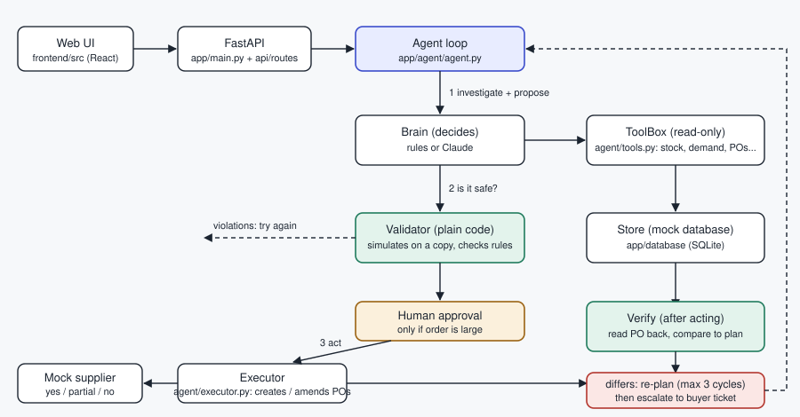

# Procura: AI Purchasing Agent

A full-stack agent that **makes, executes and validates** purchasing decisions for a quick-commerce buyer.
It investigates with tools, decides, places or amends purchase orders, then checks that reality matches its plan,
and re-plans or escalates when it does not.



- All four scenarios are implemented end to end (10 test situations).
- Runs fully offline with a built-in rules brain. Optionally use Claude as the brain.
- **Backend:** FastAPI + SQLite, layered as `core / commons / database / domain / agent / services / api`.
- **Frontend:** React + Vite, Poppins and Inter, light and dark themes.
- File-by-file map in plain words: [FILE_GUIDE.md](FILE_GUIDE.md). Design notes: [docs/ARCHITECTURE.md](docs/ARCHITECTURE.md).

## Quick start (Python only, UI is pre-built)
```bash
cd backend
python -m venv .venv && source .venv/bin/activate          # Windows: .venv\Scripts\activate
pip install -r requirements.txt
cp .env.example .env                                       # optional: add ANTHROPIC_API_KEY for the Claude brain
uvicorn app.main:app --reload                              # open http://localhost:8000
```
The database file (`backend/data/procura.db`) is created and seeded on first start.

## Develop the UI
```bash
cd frontend && npm install
npm run dev        # http://localhost:5173 (talks to the API on :8000)
npm run build      # rebuilds frontend/dist, which FastAPI serves
```

## Tests and demo
```bash
cd backend
pytest -q                      # 26 tests
python -m scripts.run_eval     # scorecard for all 10 situations
python -m scripts.demo S4b     # readable story of one run (no argument = all). Saved output: docs/DEMO_OUTPUT.md
```

## How the agent works
1. **Investigate.** Read-only tools: inventory, demand (real surge vs one-day spike), promotions, open POs, supplier options, budget, replenishment calculator. Every call is logged.
2. **Decide.** It never trusts the incoming recommendation. `target = daily demand x (lead time + review period) + safety stock`, `need = target - (on hand + incoming)`, fitted to MOQ, case size, supplier stock, budget and storage. Output: accept, modify, reject, investigate or escalate, with reasons.
3. **Validate before acting.** A plain-code validator simulates the proposal on a copy of the database and checks every constraint plus whether enough evidence was gathered.
4. **Human approval** for orders above the limit; re-validated after approval.
5. **Act** through the executor and the mock supplier API.
6. **Verify after acting.** POs are read back and the real stock position is compared with the simulated one. Rejections, partial fills and mismatches trigger a new cycle; after 3 cycles a buyer ticket is raised.

## Scenarios covered
| Case | Situation | Expected behaviour |
|---|---|---|
| S1a | Recommendation of 800 is right | accept |
| S1b | Open PO already covers demand | reject |
| S1c | Recommendation too large | modify to 600 |
| S1d | Other node already well stocked | reject |
| S2a | Supplier ships 250 of 500, stock low | amend PO, source 290 from a reliable alternate (skips the cheap unreliable one) |
| S2b | Supplier ships 250 of 500, stock enough | amend PO only |
| S3a | Sales 2.3x forecast for a week | trust the data, top up 480 |
| S3b | One day of huge sales | do not buy, ticket the buyer to investigate |
| S4a | Budget allows only part of 800 | buy the most affordable from the cheaper supplier, escalate the gap |
| S4b | Supplier rejects first order (stale price) | verify fails, re-plan at the new price, succeed in cycle 2 |

## Evaluation approach
- **Golden answers** are hand-written in `evaluation/expectations.py`, not computed by the agent's code.
- Each situation is scored on: decision correct, necessary information obtained, constraints respected (re-checked on the final database, independent of the validator), appropriate action, result validated, recovery from failure, final status.
- **Adversarial tests** (`tests/test_scenarios.py`): a brain that blindly accepts is blocked and nothing is ordered; a brain that skips investigation is rejected; a brain fixes itself from validator feedback; supplier rejection and partial fills trigger re-planning; no alternate supplier leads to escalation; unreliable suppliers are never used; large orders wait for approval.
- Run the same scorecard with Claude: `evaluate_all(brain_factory=LLMBrain)`.

## Limits and ideas
Mock data and a mock supplier. Easy extensions: stock transfer between nodes as a new executor action, supplier reliability scoring from past POs, promotional buying and seasonality in `domain/planning.py`.

Never commit `.env`. Commit in small steps so the history shows how the solution evolved.
