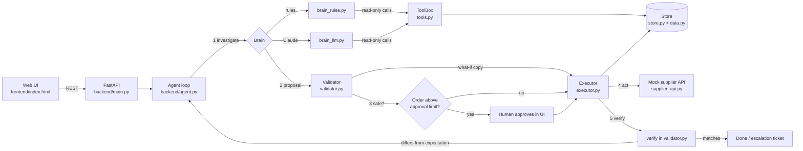

# Architecture

## The feedback loops

1. **Before acting (inner loop).** The brain proposes. `validate()` copies the data, applies the proposal
   to the copy, and checks budget, storage, overstock, MOQ, case size, supplier stock, supplier reliability,
   evidence gathered and unaddressed shortfall. Violations go back to the brain (max 3 attempts).
2. **After acting (outer loop).** The executor does it for real. `verify()` reads the purchase orders back and
   compares the real stock position to the position the simulation predicted. Rejected or partial supplier answers,
   or any mismatch, start a new cycle with the failure as feedback (max 3 cycles), then escalate to a human.

## Why the validator is plain code
The LLM can be wrong. The validator is deterministic, so an unsafe order cannot reach a supplier even if the brain
is confidently incorrect. `tests/test_scenarios.py` proves this with brains that are deliberately wrong.

## Human approval
Orders above `APPROVAL_THRESHOLD` pause in `pending_approval`. When the buyer approves, the proposal is
validated again (data may have moved) before it runs.
